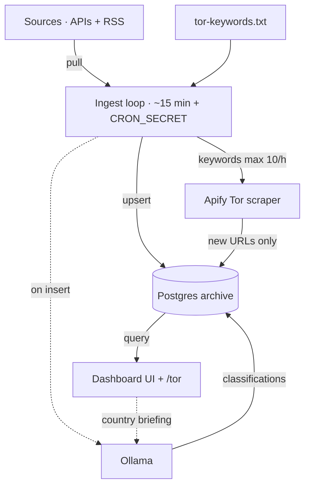

# Overlord — Architecture (simple)

**Pull → store → (optionally) classify → UI reads archive only.**

External feeds are ingested on a schedule into Postgres. The browser never calls those feeds. Ollama on the LAN labels threats and drafts country briefings. Tor keyword hits come from Apify (cloud Tor), not a local SOCKS proxy.

## Stages

| # | Stage | Plain meaning |
| --- | --- | --- |
| 1 | Sources | ransomware.live, RansomLook, Google News RSS, Telegram RSS, offline DarkForums dumps |
| 2 | Ingest | `ingest-loop.ts` → `/api/ingest/*` → normalize → upsert |
| 3 | Archive | Postgres tables are the only source of truth for pages |
| — | Ollama | Labels ransomware/news; summarizes country dossiers |
| — | Tor | Apify keyword search → `tor_hits` (unique URL; duplicates skipped) |
| 4 | UI | Overview / Public Data / Ransomware / News / Telegram / Tor — archive APIs only |

## Tables

| Table | Holds |
| --- | --- |
| `ransomware_victims` | Claimed victims (dual sources) |
| `news_items` | News (unique `link`) |
| `telegram_messages` | `@breachdetect` |
| `actors` / `actor_ips` | Forum names + IPs |
| `classifications` | Labels by `entity_type` + `entity_id` |
| `tor_hits` | Apify Tor keyword hits (unique `url`) |
| `ingest_runs` | Job audit |

## Runtime

| Piece | Where |
| --- | --- |
| Web | Next.js `:3000` |
| DB | Postgres 16 (Docker) |
| Tor | Apify actor `igolaizola/tor-dark-web-scraper` |
| Loop | Separate host process |
| Ollama | LAN host (`OLLAMA_BASE_URL`) |

## Trust boundary

- UI is archive-only (survives upstream downtime).
- Ingest is privileged (`CRON_SECRET`).
- Tor: keyword discovery via Apify only — no local SOCKS; browser still does not open `.onion`.
- Duplicate Tor URLs are never inserted twice.
